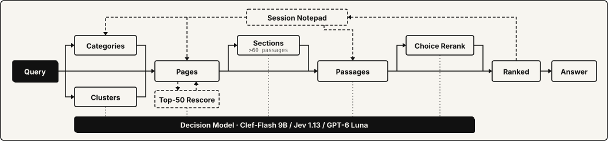

# DecisionRAG

Retriever-free document navigation and QA using decision models instead of passage embeddings.

> Inspired by *"Retriever-Free Retrieval: Navigating Documents with Decision Models"* (Wan et al., `arXiv:2610.35868`). Independent implementation, unaffiliated with the paper's authors.

## Architecture



## Quickstart

**Requirements:** Python 3.14+ and [`uv`](https://docs.astral.sh/uv/).

```bash
# 1. Install dependencies
uv sync

# 2. (Optional) Configure keys in .env — or enter them directly in the Web UI
cp .env.example .env

# 3. Start the server & Web Playground
uv run dec-rag
```

Open **`http://localhost:8000/`** in your browser:

1. **Verify APIs:** If `.env` already has a working Decision Judge and Generator LLM, they load automatically. Otherwise, use **Settings** (top-right) or the inline setup prompt to enter and test your Judge (`Test`) and Generator (`Test Generator`) keys.
2. **Upload Documents:** Click **+ Upload Documents** (or drag and drop `.pdf`, `.md`, `.html`, or `.txt` files). Documents are parsed into `Category -> Page -> Section -> Passage` in reading order with zero stored vectors.
3. **Run Queries:** Try **Query** (grounded QA), **Retrieve** (decision navigation only, no LLM needed), **Chat** (multi-turn with Session Notepad), or **Compare** (side-by-side judges) and watch the active path light up in the architecture bar.

## Supported Backends

- **Decision Judges:**
  - `clef` — Colab Cloudflare Clef-Flash 9B (`/v1/systemone`)
  - `openrouter_jev` — OpenRouter `typesafe/jev-1.13` (`/api/alpha/decisions`)
  - `openrouter_luna` — OpenRouter `openai/gpt-6-luna-decisions` (`/api/alpha/decisions`)
  - `openai_luna` — OpenAI Direct `gpt-6-luna` (`/v1/decisions`)
- **Answer Generator:** OpenAI, Azure OpenAI (`azure/<deployment>`), OpenRouter, or any LiteLLM-supported chat model.

## Development & Tests

```bash
# Run backend & API test suite
uv run pytest -v

# Customize the React + TypeScript frontend (optional — pre-built bundle is included)
cd frontend
npm install
npm run dev      # http://localhost:5173 (proxies /api -> :8000)
npm run build    # Type-checks and outputs to ../src/dec_rag/static
```

## License

Apache-2.0 — see [LICENSE](LICENSE).
